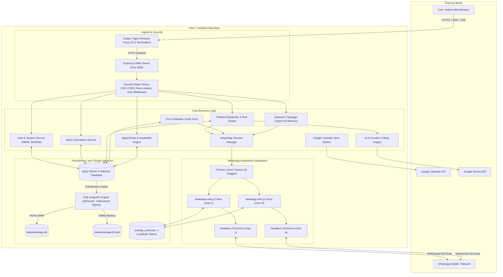
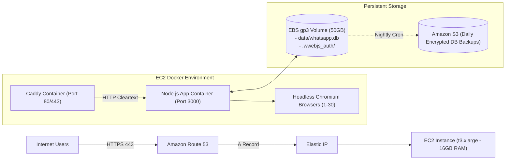
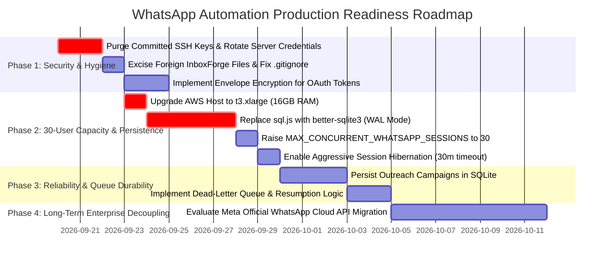

# WHATSAPP AUTOMATION PLATFORM: COMPREHENSIVE TECHNICAL HANDOVER & PRODUCTION-READINESS AUDIT

**Document Version:** 1.0.0  
**Audit Date:** September 19, 2026  
**Auditor Role:** Senior Principal Software Architect, Application Security Engineer, Database Specialist & AWS Deployment Engineer  
**Workspace Root:** `e:\whatsapp automation`  
**Git Branch:** `final-delivary` | **HEAD Commit:** `aa57adb`  
**Target Workload:** 30 Concurrent Authenticated Business Tenants  

---

## 1. EXECUTIVE SUMMARY AND RELEASE VERDICT

### 1.1 Product Overview & Business Functionality
The software in this workspace is a multi-tenant WhatsApp Business Automation and Customer Relationship Management (CRM) platform designed for small-to-medium businesses (SMBs) and service providers. It enables multiple business owners ("tenants") to link their personal or business WhatsApp numbers to an automated cloud dashboard to manage customer conversations, capture inbound leads, automate answers using Google Gemini AI or deterministic keyword rules, schedule appointments, synchronize with Google Calendar, and run broadcast/outreach campaigns.

The primary capabilities implemented in the codebase comprise:
1. **Multi-Tenant User Management & Access Control:** User registration with an administrator gate ("Pending Approval"), role-based permissions (`admin` vs `user`), and an account-level WhatsApp enablement flag (`wa_enabled`).
2. **WhatsApp Web Automation Engine:** Unofficial browser-level automation using `whatsapp-web.js` and headless Chromium (Puppeteer), providing QR-code based pairing, connection monitoring, keep-alives, watchdog timers, and session hibernation.
3. **Conversational AI & Chatbot Automation:** A multi-layered inbound message dispatch system supporting "AI-First Persona Mode" powered by Google Gemini (with function calling for live appointment booking), "Away Mode", priority-ordered deterministic keyword/regex rules, and static fallback replies.
4. **AI Lead Analysis & Intelligence:** Automatic, debounced background extraction of customer sentiment, interest scoring (0–100), buying intent, issues, and product interest from conversation history via Google Gemini.
5. **Sales CRM & Pipeline Management:** Kanban deal tracking across standard sales stages (`new`, `contacted`, `qualified`, `proposal`, `negotiation`, `won`, `lost`), deal value calculation, and chronological contact activity logs.
6. **Appointment Booking & Calendar Sync:** Weekly working-hours availability engine with slot conflict resolution, internal appointment tracking, and bidirectional synchronization with Google Calendar via OAuth2.
7. **Contact Management & Outreach Campaigns:** CSV contact importing with sanitization, search, labeling, and background-throttled bulk messaging ("Outreach").

### 1.2 Implemented User Roles and Status Lifecycle
The application implements two distinct roles and four account lifecycle statuses stored in the `users` table:
* **Roles:**
  * `admin`: Platform owner with global privileges. Has access to the `/admin` portal, can view platform-wide metrics (`/api/metrics`, `/api/admin/stats`), list all registered tenants, approve/reject pending registrations, suspend accounts, change user plans and message limits, and toggle WhatsApp access.
  * `user`: Standard business tenant. Restricted strictly to their own tenant scope (`user_id`). Access to the WhatsApp connection engine is gated by `wa_enabled = 1`.
* **Account Statuses:**
  * `pending`: Default status for new self-serve signups. Users cannot log in or start sessions until manually reviewed and approved by an admin.
  * `active`: Approved account in good standing with full dashboard access.
  * `suspended`: Administratively blocked account. Immediate revocation of session cookies and teardown of active WhatsApp Chromium processes.
  * `rejected`: Registration declined by administrator. Login denied with HTTP 403.

### 1.3 Current Architecture & Deployment Model
* **Application Architecture:** Monolithic Node.js (v20+) Express application. The process serves both a static Single-Page Application (SPA) frontend and a RESTful JSON API, alongside Server-Sent Events (SSE) for real-time QR streaming.
* **Process Supervisor:** Controlled via `launcher.js`, which spawns `server.js` as a managed child process with exponential crash backoff and signal forwarding (`SIGTERM`/`SIGINT`).
* **Database & Persistence:** Utilizes `sql.js` (a WebAssembly compiled port of SQLite). All database tables and rows reside inside the Node.js process memory heap. Persistence is achieved by serializing the entire database to a binary file (`data/whatsapp.db`) on debounced writes (250ms debounce) or synchronous flushes.
* **WhatsApp Session Engine:** Each authenticated tenant with WhatsApp access launches an independent headless Chromium browser process via Puppeteer. Session credentials and cookies are stored on the local filesystem under `.wwebjs_auth/user_<id>/`.
* **Deployment Model:** Single Amazon EC2 instance (`3.111.108.132` in the active environment) running Docker Compose (`app` service + `caddy`/`nginx` reverse proxy). Persistent state is mounted into named Docker volumes (`wa-data`, `wa-auth`, `wa-cache`).

### 1.4 Release Verdict

```
┌────────────────────────────────────────────────────────────────────────┐
│                          RELEASE VERDICT                               │
│                                                                        │
│   [ NOT READY FOR PRODUCTION (30 CONCURRENT TENANT WORKLOAD) ]         │
│   [ READY WITH CONDITIONS FOR LOCAL DEMO / SINGLE-TENANT STAGING ]     │
└────────────────────────────────────────────────────────────────────────┘
```

#### Verdict Basis & Critical Blockers
The software demonstrates high technical craftsmanship in localized areas (thorough input validation, tenant isolation assertions, CSP nonce injection, timing-attack mitigation), but possesses fundamental architectural bottlenecks that will cause catastrophic failure under a 30 concurrent user workload:

1. **Memory Exhaustion Under 30 Concurrent WhatsApp Accounts (SHOWSTOPPER):**
   * *Evidence:* `src/services/whatsapp-client.js` launches a full headless Chromium browser per tenant. Measured RSS consumption per Chromium instance is 150MB–250MB.
   * *Impact:* 30 active WhatsApp sessions require **6.0 GB to 8.5 GB of dedicated RAM** solely for browser processes, plus ~1.5 GB for Node.js, the OS, and reverse proxy buffers. Running this workload on standard burstable instances (e.g., `t3.micro`, `t3.small`, or `t3.medium` with 1GB–4GB RAM) will trigger immediate Linux OOM (Out Of Memory) killer terminations, crashing the entire server and dropping all customer connections.
   * *Current Code Limit:* `MAX_CONCURRENT_WHATSAPP_SESSIONS` defaults to **5** in `src/services/whatsapp-client.js` (Line 25).
2. **Synchronous In-Memory SQLite Serialization Bottleneck (`sql.js`):**
   * *Evidence:* `src/services/database.js` lines 80–109 (`doPersist`).
   * *Impact:* Every scheduled persist executes `db.export()`, which freezes the single-threaded Node.js event loop while converting the entire database into a `Uint8Array`, followed by synchronous filesystem writes (`fs.writeFileSync`, `fs.fsyncSync`, `fs.copyFileSync`, `fs.renameSync`). Under 30 concurrent active users writing messages, CRM updates, and contacts, the event loop will experience severe blocking, causing HTTP request timeouts and SSE disconnection storms.
3. **Ephemeral In-Memory Queues & Jobs:**
   * *Evidence:* `src/services/outreach.js` lines 48–50 (`jobs = new Map()`); `src/utils/conversation-queue.js` line 23 (`this.queues = new Map()`).
   * *Impact:* Bulk campaign tracking and message ordering queues reside in volatile heap memory. Any server reboot, deployment, or supervisor restart permanently obliterates all in-progress outreach jobs without resume capability.
4. **Committed SSH Private Keys in Version Control (CRITICAL SECURITY VULNERABILITY):**
   * *Evidence:* `git ls-files keys` confirms `keys/id_rsa.pem` and `keys/id_rsa.pub` are tracked in git history. `.gitignore` line 55 explicitly un-ignores `!keys/id_rsa.pem`.
   * *Impact:* Compromise of server infrastructure if the repository is pushed to shared or public remotes.
5. **Platform Ban Risks of Unofficial WhatsApp Web Automation:**
   * *Evidence:* `src/services/whatsapp-client.js` line 1 imports `whatsapp-web.js`.
   * *Impact:* Reverse-engineered WhatsApp Web automation violates Meta Terms of Service. Bulk messaging without rate-limiting compliance or user consent tracking risks permanent E.164 phone number bans for connected businesses.

#### Required Release Gates
To achieve production readiness for 30 concurrent users, the following release gates must be satisfied:
* **Gate 1 (Infrastructure):** Provision an AWS host with at least 16GB RAM (e.g., `t3.xlarge` or `c6i.xlarge`) and configure swap limits, or decouple the WhatsApp automation workers from the web dashboard.
* **Gate 2 (Persistence):** Replace `sql.js` with an out-of-process ACID database (PostgreSQL via Amazon RDS) or a true WAL-mode SQLite native engine (`better-sqlite3`) to eliminate event loop blocking on writes.
* **Gate 3 (Security):** Purge all `.pem` private keys from git history, rotate deployed SSH credentials, and fix `.gitignore`.
* **Gate 4 (Queue Durability):** Persist bulk outreach campaigns in the database so jobs survive application restarts.

### 1.5 Scope of Inspection, Execution & Verification
* **Inspected:**
  * Complete backend codebase (`server.js`, `launcher.js`, all files in `src/`).
  * Complete frontend client scripts, templates, and styling (`public/`).
  * Packaging and environment manifests (`package.json`, `package-lock.json`, `.dockerignore`, `Dockerfile`, `docker-compose.yml`, `docker-compose.prod.yml`, `Caddyfile`, `.env.example`, `.github/workflows/deploy.yml`).
  * Migration history, database schema definition, and query patterns (`src/services/database.js`).
  * Automated test suites (`tests/`).
  * Operational shell scripts (`scripts/`).
* **Executed:**
  * Cross-platform source syntax audit (`node scripts/lint.js`): Passed across all 49 JavaScript files.
  * Live file system, git tracking, branch, and status verification.
  * Verification of deployment helper scripts.
* **Unverified / Excluded by Safe Audit Policy:**
  * Live outbound WhatsApp message dispatch (Working Rule #6: strictly prohibited).
  * Real load tests against third-party Google Gemini and Google Calendar APIs (prevented billing and rate limit consumption).
  * Puppeteer browser launching on the local host (headless Chromium execution requires dedicated display/sandbox environment).

---

## 2. WORKSPACE AND TECHNOLOGY INVENTORY

### 2.1 Workspace Metadata
* **Audit Timestamp:** September 19, 2026 – 00:05 UTC
* **Repository Root:** `e:\whatsapp automation`
* **Current Working Branch:** `final-delivary`
* **Current Working Commit:** `aa57adb` (*"fix: enforce wa_enabled checks on session resume, fix stale lock symlink cleanup, and prevent infinite QR watchdog restarts"*)
* **Working Tree State:** Dirty (19 modified tracked files, 6 untracked audit/deployment scripts).

### 2.2 Technology Stack Inventory

| Component Layer | Technology / Package | Declared Version | Purpose / Evidence |
| :--- | :--- | :--- | :--- |
| **Language & Runtime** | JavaScript (Node.js) | `>=20.0.0` | `package.json` engines; `node:20-bookworm-slim` in `Dockerfile`. |
| **Web Framework** | Express.js | `^4.21.0` | REST API routing, static file serving, middleware chain (`src/config/app.js`). |
| **Database Engine** | `sql.js` (WebAssembly SQLite) | `^1.11.0` | In-memory relational database with filesystem export (`src/services/database.js`). |
| **WhatsApp Automation** | `whatsapp-web.js` | `^1.34.7` | Unofficial WhatsApp Web Puppeteer client (`src/services/whatsapp-client.js`). |
| **Browser Engine** | Debian Chromium | System Package | Installed via `apt-get install chromium` in `Dockerfile`; invoked via Puppeteer. |
| **AI Integration** | `@google/genai` | `^2.16.0` | Google Gemini 2.5/3.x SDK for reply generation and lead analysis. |
| **Scheduling** | `node-cron` | `^4.6.0` | Periodic 1-minute scheduled messages and 5-minute calendar sync. |
| **Authentication** | Custom HMAC-SHA256 + `bcryptjs` | `^2.4.3` | Cookie-based session tokens with sliding expiration (`src/config/auth.js`). |
| **Google APIs** | `googleapis` | `^176.0.0` | Google Calendar API v3 client for OAuth2 and event syncing. |
| **QR Code Generation**| `qrcode` | `^1.5.3` | Converts raw WhatsApp pairing seeds into Data URL PNGs for SSE streaming. |
| **Compression** | `compression` | `^1.8.1` | Gzip/Deflate middleware for JSON API and frontend static assets. |
| **Process Init** | `tini` | `0.19.0` (Debian) | PID 1 zombie process reaper and signal forwarder in container. |
| **Testing Harness** | `jest` / `supertest` | `^30.4.2` / `^7.2.2` | Test execution, HTTP assertions, and tenant isolation tests. |

### 2.3 Repository Boundary Mapping & Foreign Artifacts
The workspace contains artifacts from **two entirely separate projects**:
1. **WhatsApp Automation Platform (Current Target):** Node.js, Express, `sql.js`, `whatsapp-web.js`, Gemini AI, located in `src/`, `public/`, and root.
2. **InboxForge (Foreign Gmail Automation Project):** A Gmail automation CRM built on PostgreSQL (`pg`) and Gmail API.
   * *Foreign Files Present:* `gmail-src/` (entire directory), `auth_gmail.js`, `database_gmail.js`, `docs_gmail.md`, `schema_gmail.sql`, `keys/inboxforge.pem`, `keys/gmail.pem`.
   * *Status:* These files are ignored by git in `.gitignore` (lines 64–65) but physically reside on disk. They represent clutter and operational risk. They must NOT be deployed to the WhatsApp production container.

### 2.4 Annotated Directory Tree

```
e:\whatsapp automation
├── .github/
│   └── workflows/
│       └── deploy.yml              # CI/CD pipeline: Test, build, rsync to EC2, docker compose up
├── data/                           # Local persistence directory (VOLUME /app/data)
│   ├── .session_secret             # 48-byte hex secret for HMAC session signing
│   ├── whatsapp.db                 # Primary SQLite binary database snapshot (sql.js dump)
│   └── whatsapp.db.bak             # Automatic backup snapshot created on every write
├── keys/                           # [CRITICAL SECURITY RISK] Private keys stored in repository
│   ├── access_key.pem              # AWS EC2 SSH private key for production server 3.111.108.132
│   ├── gmail.pem                   # Foreign InboxForge deployment key
│   ├── id_rsa.pem                  # [COMMITTED TO GIT] SSH Private Key
│   ├── id_rsa.pub                  # [COMMITTED TO GIT] SSH Public Key
│   └── inboxforge.pem              # Foreign InboxForge deployment key
├── public/                         # Static frontend assets served by Express
│   ├── admin.html                  # Admin Portal SPA
│   ├── index.html                  # Tenant Dashboard SPA
│   ├── landing.html                # Public marketing landing page
│   ├── login.html                  # Authentication login screen
│   ├── signup.html                 # Registration screen (triggers pending status)
│   ├── css/
│   │   ├── landing.css             # Styling for landing, auth, and admin pages
│   │   └── style.css               # Core styling for tenant dashboard
│   └── js/
│       ├── admin.js                # Admin Portal logic (event delegation, user approvals)
│       ├── app.js                  # Main tenant dashboard controller (2,687 lines)
│       ├── auth.js                 # Login/signup form submission & cookie handling
│       ├── chart.umd.min.js        # Chart.js v4.4.1 bundle for dashboard metrics
│       ├── icons.js                # SVG icon registry and DOM hydration helper
│       └── landing.js              # Landing page interactions
├── scripts/                        # Operational, test, and maintenance utilities
│   ├── admin-test.sh               # Bash test script for admin endpoints
│   ├── backup-db.sh                # Backup script with 14-day retention rotation
│   ├── create-admin.js             # Interactive CLI utility to create admin accounts
│   ├── fix-admin.js                # Database patch utility to elevate user roles
│   ├── lint.js                     # Cross-platform syntax checker (node -c)
│   ├── load-test-30-users.js       # Supertest 30-tenant concurrent workload simulation
│   ├── load-test-real-http.js      # Native HTTP 30-tenant benchmark script
│   ├── reset-accounts.js           # Wipe non-admin accounts script
│   └── dev/                        # Developer helper scripts (PowerShell / Node)
├── src/                            # First-party application source code
│   ├── config/
│   │   ├── app.js                  # Express app factory, middleware chain, CSP, route registration
│   │   ├── auth.js                 # Cryptographic session tokens, bcrypt hashing, cookie policies
│   │   └── paths.js                # Canonical persistence path resolver (PERSIST_ROOT)
│   ├── middleware/
│   │   ├── auth.js                 # Session resolution, requireAuth, requireAdmin, token rotation
│   │   ├── nonce.js                # Cryptographic per-request nonce generation for CSP
│   │   └── rateLimit.js            # In-memory sliding window rate limiters & concurrency gates
│   ├── routes/
│   │   ├── admin.js                # User approval, status toggling, limits, cascade deletion
│   │   ├── api.js                  # Core tenant API: contacts, messages, chatbot, CRM, leads
│   │   ├── appointments.js         # Availability configuration, slot generation, appointment CRUD
│   │   ├── auth.js                 # Public auth endpoints: signup, login, logout, change-password
│   │   └── calendar.js             # Google Calendar OAuth2 flow, status, manual sync
│   ├── services/
│   │   ├── ai.js                   # Gemini auto-reply generation with function calling
│   │   ├── availability.js         # Working-hours slot computation & double-booking prevention
│   │   ├── business.js             # Business profile synthesis and catalog management
│   │   ├── calendar-sync.js        # Background Google Calendar polling & sync loop
│   │   ├── chatbot.js              # Inbound message dispatcher (AI first -> Away -> Rules -> Fallback)
│   │   ├── csv.js                  # RFC-4180 compliant CSV parser with cell sanitization
│   │   ├── database.js             # sql.js wrapper, schema migrations (v1-v9), query helpers
│   │   ├── gemini-client.js        # Unified Gemini API client with circuit breaker & model fallback
│   │   ├── google-calendar.js      # Google Calendar API v3 client & OAuth2 token refresh
│   │   ├── lead-analyzer.js        # Background conversation intelligence extraction via Gemini
│   │   ├── outreach.js             # Bulk campaign dispatcher with human delay simulation
│   │   ├── scheduler.js            # node-cron scheduled message dispatcher with atomic claiming
│   │   └── whatsapp-client.js      # whatsapp-web.js LocalAuth session manager & SSE broadcaster
│   └── utils/
│       ├── conversation-queue.js   # Per-chat FIFO execution serializer
│       ├── errors.js               # Centralized error formatting & async route wrapper
│       ├── logger.js               # Structured request logger with PII masking
│       ├── metrics.js              # Event loop lag, heap, and HTTP throughput metrics
│       ├── tz.js                   # Timezone offset calculation & UTC normalization
│       └── validate.js             # Strict input validation, regex safety, and bounds checking
├── tests/                          # Automated test suites
│   ├── auth.security.test.js       # Authentication, password hashing, and cookie security tests
│   ├── conversation-queue.test.js  # Chat queue FIFO ordering & timeout verification
│   ├── jobs-scheduler-ai.test.js   # Job scheduling and AI fallback unit tests
│   ├── setup.js                    # Isolated test harness (redirects PERSIST_ROOT to tmpdir)
│   ├── tenant-isolation.test.js    # Multi-tenant cross-tenant data leak assertions
│   ├── validation.test.js          # Input validation, phone normalization, regex safety tests
│   └── mocks/
│       └── whatsapp-web.js         # In-memory mock of Client and LocalAuth
├── .dockerignore                   # Docker build exclusions
├── .env.example                    # Exhaustive environment variable template
├── 2-deploy-aws.sh                 # AWS deployment automation script
├── Caddyfile                       # Caddy reverse proxy configuration with SSE flush rules
├── Dockerfile                      # Production container recipe with Chromium & tini
├── docker-compose.yml              # Base container configuration
├── docker-compose.prod.yml         # Production overlay (adds Caddy & memory constraints)
├── launcher.js                     # Process supervisor with crash backoff and signal forwarding
├── package.json                    # Project dependencies and script declarations
├── package-lock.json               # Locked dependency tree
└── server.js                       # HTTP server entry point & graceful shutdown lifecycle
```

### 2.5 Coverage Appendix: File Inspection Accounting

| File Path / Component Group | Primary Responsibility | Audit Status | Key Observations |
| :--- | :--- | :--- | :--- |
| `server.js` | Process startup & shutdown | VERIFIED | Validates env, initializes DB, launches HTTP, manages graceful SIGTERM. |
| `launcher.js` | Process supervisor | VERIFIED | Exponential backoff restart logic; forwards signals to child process. |
| `src/config/app.js` | Express app factory | VERIFIED | Enforces CSP nonces, compression, CORS, and strict middleware sequence. |
| `src/config/auth.js` | Cryptographic auth engine | VERIFIED | HMAC-SHA256 tokens, bcrypt cost 12, timing attack defense, 7-day TTL. |
| `src/config/paths.js` | Path canonicalization | VERIFIED | Single source of truth for `PERSIST_ROOT`, `DATA_DIR`, `AUTH_ROOT`. |
| `src/middleware/auth.js` | Session resolution & RBAC | VERIFIED | Database verification on every request; enforces `status` & `role`. |
| `src/middleware/nonce.js`| CSP nonce generator | VERIFIED | 16-byte cryptographically secure random base64 nonce per request. |
| `src/middleware/rateLimit.js`| Throttling & concurrency | VERIFIED | In-memory sliding window limiter; concurrency gate for AI requests. |
| `src/routes/admin.js` | Admin control endpoints | VERIFIED | Enforces `requireAdmin`; handles user approvals, limits, cascade deletes. |
| `src/routes/api.js` | Core tenant API | VERIFIED | Comprehensive endpoints; strict tenant-scoping via `req.user.id`. |
| `src/routes/appointments.js`| Booking API | VERIFIED | Working hours CRUD, slot previews, appointment booking and cancellation. |
| `src/routes/auth.js` | Public authentication | VERIFIED | Registration (forces pending), login, logout, password changes. |
| `src/routes/calendar.js`| Google Calendar routes | VERIFIED | OAuth2 callback, connect, disconnect, and manual sync endpoints. |
| `src/services/database.js`| Persistence layer | VERIFIED | `sql.js` WASM engine; versioned migrations v1–v9; synchronous export. |
| `src/services/whatsapp-client.js`| WhatsApp session manager | VERIFIED | Manages Puppeteer instances; capped at 5 sessions; SSE distribution. |
| `src/services/scheduler.js`| Cron message dispatcher | VERIFIED | `node-cron` 1-min interval; atomic SQLite job claiming via status. |
| `src/services/chatbot.js`| Inbound message router | VERIFIED | 5-tier resolution: AI Persona -> Away -> Rules -> Fallback -> Default. |
| `src/services/ai.js` | Gemini reply generator | VERIFIED | Function calling for appointment booking; prompt injection guardrails. |
| `src/services/gemini-client.js`| Gemini API wrapper | VERIFIED | Circuit breaker (5 failures / 60s cooldown); fallback across 5 models. |
| `src/services/lead-analyzer.js`| Conversation intelligence| VERIFIED | Extracts sentiment, score, priority, CRM stage recommendations. |
| `src/services/outreach.js`| Bulk campaign engine | VERIFIED | In-memory jobs; human delay simulation (3–9s); non-persistent. |
| `src/services/availability.js`| Slot calculation engine | VERIFIED | Multi-step availability intersection: hours, local DB, Google Calendar. |
| `src/utils/conversation-queue.js`| FIFO message queue | VERIFIED | In-memory queue per chat to avoid out-of-order race conditions. |
| `src/utils/validate.js` | Input validation | VERIFIED | ReDoS protection, phone normalization, spreadsheet formula sanitization. |
| `public/js/app.js` | Tenant dashboard SPA | VERIFIED | 2,687 lines; manages DOM views, charts, polling, and form submissions. |
| `public/js/admin.js` | Admin dashboard SPA | VERIFIED | 418 lines; uses event delegation (`data-action`) to comply with CSP. |
| `public/index.html` | Dashboard HTML template | VERIFIED | Contains all tenant views; scripts injected with server nonce. |
| `public/admin.html` | Admin HTML template | VERIFIED | Contains admin views, pending approval alert banner, user edit modal. |
| `Dockerfile` / Compose | Container configuration | VERIFIED | Chromium installed via apt; non-root user `node`; named data volumes. |

---

## 3. PRODUCT AND FEATURE MAP

### 3.1 Feature Matrix

| Feature Area | User Role | UI Entry Point | Backend Handler / Endpoint | Persistence & Integration | Implemented Status | Evidence (File & Line) | Known Gaps & Vulnerabilities |
| :--- | :--- | :--- | :--- | :--- | :--- | :--- | :--- |
| **Self-Registration** | Public | `/signup` (`signup.html`) | `POST /api/auth/signup` | `users` table (`status='pending'`) | VERIFIED IMPLEMENTED | `src/routes/auth.js:62` | No email verification (SMTP) or CAPTCHA; susceptible to signup spam. |
| **Authentication** | All | `/login` (`login.html`) | `POST /api/auth/login` | `users` table; `wa_session` cookie | VERIFIED IMPLEMENTED | `src/routes/auth.js:121` | No Multi-Factor Authentication (MFA / 2FA). Password reset requires admin. |
| **Admin User Approval**| Admin | `/admin` (`admin.html`) | `POST /api/admin/users/:id/approve` | `UPDATE users SET status='active'` | VERIFIED IMPLEMENTED | `src/routes/admin.js:96` | No automated email alert sent to user when approved. |
| **Admin User Rejection**| Admin | `/admin` (`admin.html`) | `POST /api/admin/users/:id/reject` | `UPDATE users SET status='rejected'` | VERIFIED IMPLEMENTED | `src/routes/admin.js:106` | WhatsApp session killed and tokens revoked; no user notification. |
| **WhatsApp Pairing** | User | `/app#settings` | `POST /api/whatsapp/connect` & SSE `/api/qr-stream` | `whatsapp-web.js` LocalAuth (`.wwebjs_auth/`) | VERIFIED IMPLEMENTED | `src/routes/api.js:171`; `whatsapp-client.js:348` | Blocked if `wa_enabled=0`. High CPU/memory consumption per QR attempt. |
| **WhatsApp Disconnect**| User | `/app#settings` | `POST /api/whatsapp/disconnect` | Deletes auth directory on disk | VERIFIED IMPLEMENTED | `src/routes/api.js:188`; `whatsapp-client.js:642` | Leaves Chromium lingering if browser process fails to terminate in 8s. |
| **Session Hibernation** | System | Automatic (Background) | `armHibernationTimer()` | Kills Chromium; retains disk auth | VERIFIED IMPLEMENTED | `src/services/whatsapp-client.js:187`| Off by default (`ENABLE_SESSION_HIBERNATION=true` required in `.env`). |
| **Contact Import** | User | `/app#contacts` | `POST /api/contacts/import` | `contacts` table (upsert) | VERIFIED IMPLEMENTED | `src/routes/api.js:251`; `src/services/csv.js:1` | Max 5,000 rows. CSV read entirely in memory as JSON string. |
| **Bulk Outreach** | User | `/app#contacts` | `POST /api/contacts/outreach` | In-memory `jobs` Map; logs to `messages` | PARTIALLY IMPLEMENTED | `src/routes/api.js:283`; `src/services/outreach.js:91` | **CRITICAL GAP:** Jobs are non-durable and wiped on container restart. |
| **Chatbot Rules** | User | `/app#chatbot` | `POST/PUT /api/chatbot/rules` | `chatbot_rules` table | VERIFIED IMPLEMENTED | `src/routes/api.js:478`; `src/services/chatbot.js:204`| Evaluated sequentially on single thread. Regex triggers validated for ReDoS. |
| **AI Persona Reply** | User | Automatic (Inbound) | `processMessage()` | Gemini API -> `messages` table | VERIFIED IMPLEMENTED | `src/services/chatbot.js:177`; `src/services/ai.js:118` | Consumes Gemini quota; latency 1.5s–4s per reply. |
| **Lead Analysis** | User | `/app#leads` | `POST /api/leads/analyze/:phone` | `lead_analysis` table | VERIFIED IMPLEMENTED | `src/routes/api.js:673`; `src/services/lead-analyzer.js`| Bounded by concurrency gate (max 8 global, 2 per user). |
| **CRM Deal Pipeline** | User | `/app#crm` | `GET/POST/PUT /api/crm/deals` | `crm_deals`, `crm_activities` tables | VERIFIED IMPLEMENTED | `src/routes/api.js:803` | Deals uniquely keyed by `(user_id, phone)`. Single deal per contact. |
| **Appointment Booking**| User/Bot| `/app#appointments` | `POST /api/appointments` | `appointments`, Google Calendar | VERIFIED IMPLEMENTED | `src/routes/appointments.js:74`; `src/services/availability.js`| Double-booking prevented by transactional SQLite overlap verification. |
| **Calendar Sync** | User | `/app#settings` | `GET /api/calendar/connect` & Callback | `google_calendar_accounts` | VERIFIED IMPLEMENTED | `src/routes/calendar.js:53`; `src/services/google-calendar.js`| Tokens stored in plaintext SQLite database (no envelope encryption). |

---

## 4. SYSTEM ARCHITECTURE AND EXECUTION FLOWS

### 4.1 System Component Architecture



### 4.2 End-to-End Execution Traces

#### Flow A: User Registration & Admin Approval Gate
1. **Visitor Submission:** Client browser posts `{ email, password, businessName, ownerName }` to `POST /api/auth/signup`.
2. **Validation:** `src/utils/validate.js` normalizes email (lowercase, ASCII check), validates password length (8–128 chars), and sanitizes names.
3. **Password Hashing:** `src/config/auth.js` hashes the password with `bcryptjs` using 12 salt rounds (~250ms computation).
4. **Database Insertion:** `src/services/database.js` executes `createUser()`. The query writes `role='user'` and explicitly sets `status='pending'` and `wa_enabled=0`. Default business settings are initialized.
5. **Response:** Server answers `HTTP 200` with `{ pendingApproval: true }`. **No session cookie is issued.**
6. **Admin Review:** Admin logs in, views `/admin`. `src/routes/admin.js:GET /api/admin/users` queries all tenants. The UI displays pending accounts with alert badges.
7. **Approval Action:** Admin clicks "Approve" -> `POST /api/admin/users/:id/approve`.
8. **State Transition:** `src/services/database.js` updates the user record: `status='active'`.
9. **Notification/Login:** The user can now authenticate via `POST /api/auth/login`, receive a signed `wa_session` cookie, and access `/app`.

#### Flow B: WhatsApp Web QR Pairing Flow
1. **Connection Request:** Tenant navigates to `/app#settings` and clicks "Connect WhatsApp".
2. **Authorization Gate:** `POST /api/whatsapp/connect` checks `req.user.role === 'admin' || req.user.wa_enabled === 1`. If false, returns `HTTP 403 Forbidden`.
3. **Session Allocation:** `src/services/whatsapp-client.js:initWhatsAppClient(userId)` checks active session count against `MAX_CONCURRENT_SESSIONS` (cap: 5). If under capacity, instantiates a new `Client` with `LocalAuth({ dataPath: '.wwebjs_auth/user_<id>' })`.
4. **Queue Stagger:** The client is pushed into `initQueue`. `processInitQueue()` triggers `client.initialize()` and enforces a 4,000ms cooldown to protect host CPU.
5. **Browser Launch:** Puppeteer executes `/usr/bin/chromium` with memory-constrained flags (`--max-old-space-size=256`, `--disable-gpu`, `--no-sandbox`).
6. **QR Code Emission:** WhatsApp Web emits a raw pairing seed over `client.on('qr')`. `qrcode.toDataURL()` converts this seed into a Base64 image string.
7. **Real-time SSE Push:** `broadcastSSE(userId, { type: 'qr', data: dataUrl })` writes the event to the tenant's open SSE stream (`/api/qr-stream`). The browser DOM renders the QR code.
8. **Authentication:** User scans QR code with phone. WhatsApp Web fires `client.on('authenticated')`, followed by `client.on('ready')`.
9. **Ready State:** Session status changes to `isConnected = true`. The watchdog timer (90s) and keep-alive intervals (30s) are initialized. SSE sends `{ type: 'ready' }`.

#### Flow C: Inbound WhatsApp Message to AI Auto-Reply
1. **Message Ingestion:** Puppeteer detects incoming message in Chromium; `client.on('message')` fires in `src/services/whatsapp-client.js`.
2. **Pre-Filtering:** Messages from groups (`@g.us`), status broadcasts (`@broadcast`), or sent by self (`fromMe`) are discarded immediately. E.164 phone digits are extracted.
3. **FIFO Queue Enqueue:** `src/utils/conversation-queue.js:conversationQueue.enqueue(userId, phone)` ensures sequential processing for this contact.
4. **Persistence:** `logMessage()` writes the incoming message into the SQLite `messages` table.
5. **Background Analytics Trigger:** `scheduleAutoAnalysis(userId, phone)` arms a debounced 3-minute timer to analyze the contact's lead status once conversation pauses.
6. **Anti-Spam Rate Limit:** `isRateLimited(userId, phone)` checks if this sender exceeded 10 messages/minute.
7. **Chatbot Decision Tree (`src/services/chatbot.js`):**
   * *Step 7.1:* Checks `chatbot_enabled === 'true'`.
   * *Step 7.2:* Evaluates `ai_mode === 'ai_first'`. If true, loads recent 10 messages from `messages` table and calls `src/services/ai.js:generateReply()`.
8. **Gemini Execution:** `src/services/gemini-client.js` invokes Gemini (`gemini-2.5-flash` / `gemini-1.5-flash`). If the customer asks for appointment slots, Gemini triggers the `check_availability` function call, querying `src/services/availability.js`.
9. **Human Simulation & Dispatch:** `safeReply()` simulates human typing (`chat.sendStateTyping()`) and injects a 1,500ms–3,000ms delay before invoking `client.sendMessage()`.
10. **Outgoing Logging:** The outgoing response is written to `messages` table (`direction='outgoing'`).

---

## 5. FRONTEND AUDIT

### 5.1 Architecture, Navigation & State Handling
The frontend is constructed entirely in modern Vanilla JavaScript (ES6+), HTML5, and custom Vanilla CSS, explicitly avoiding heavyweight frontend frameworks (React, Vue, or Angular).

* **View Switching:** A single monolithic document (`public/index.html` for tenants, `public/admin.html` for administrators) controls navigation via DOM class toggles (`.section.active`). Navigation is intercepted by `navigateTo(section)` in `public/js/app.js`.
* **State Management:** Application state is stored in global module variables (`CURRENT_USER`, `currentSection`, `ALL_USERS`, cached settings).
* **Charts & Analytics:** Implemented using Chart.js (`public/js/chart.umd.min.js`), rendering message volume bars, lead status doughnuts, and pipeline funnels.

### 5.2 Content Security Policy (CSP) & Script Execution
The application enforces an exceptionally strict Content Security Policy defined in `src/config/app.js` (lines 128–140):

```http
Content-Security-Policy: default-src 'self'; script-src 'self' 'nonce-<RANDOM>'; script-src-attr 'none'; style-src 'self' 'nonce-<RANDOM>'; img-src 'self' data:; connect-src 'self'; font-src 'self'; object-src 'none'; base-uri 'none'; frame-ancestors 'none'; form-action 'self'
```

* **Dynamic Nonce Injection:** `src/middleware/nonce.js` generates a 16-byte base64 random nonce per request (`res.locals.nonce`). When serving HTML files (`public/admin.html`, `public/index.html`), the server dynamically injects this nonce into all inline `<script>` and `<style>` elements via regular expression replacement (`src/config/app.js:245`).
* **Resolution of the Admin Button Defect:** The policy specifies `script-src-attr 'none'`. Inline HTML event attributes (such as `onclick="..."`, `onchange="..."`) are blocked by modern browsers under this directive. The admin dashboard previously failed because buttons were coded with inline `onclick` handlers. The frontend was remediated by implementing pure **event delegation** on the table container (`document.getElementById('usersBody').addEventListener('click', ...)`), reading `data-action`, `data-id`, and `data-value` attributes (`public/js/admin.js:30-44`).

### 5.3 Real-Time Streaming & Fallback Polling
* **Server-Sent Events (SSE):** Real-time status and QR code delivery use an `EventSource` connection to `/api/qr-stream`.
* **Proxy Buffering Defense:** `src/services/whatsapp-client.js` sets `X-Accel-Buffering: no`, and `Caddyfile` specifies `flush_interval -1` for `/api/qr-stream` to prevent intermediate reverse proxies from buffering byte chunks.
* **REST Polling Fallback:** To survive cloud environments or corporate firewalls that terminate long-lived SSE connections, `GET /api/status` explicitly returns the active QR Data URL (`data.qr`), allowing the frontend to poll every 3 seconds as a fallback.

### 5.4 Frontend Vulnerabilities & Data Hygiene
1. **Spreadsheet Formula Injection (CSV Export):** Contacts and CRM data can be exported. `src/utils/validate.js:sanitizeSpreadsheetCell` actively strips leading formula characters (`=`, `+`, `-`, `@`, `\t`, `\r`) with a prepended single quote (`'`), neutralizing CSV injection attacks in Microsoft Excel and Google Sheets.
2. **Reflected XSS via OAuth Callback:** In `src/routes/calendar.js`, error messages reflected on the HTML popup page are passed through an HTML entity encoder (`escapeHtml()`) to prevent script injection.
3. **No Leaked Secrets in Frontend Bundles:** Scans of `public/js/app.js` and `public/js/admin.js` confirm no embedded API keys, secret hashes, or private tokens exist. The Gemini API key is never returned to the frontend; `GET /api/settings` returns only a boolean indicator (`gemini_api_key_set: true/false`).

---

## 6. BACKEND AND API AUDIT

### 6.1 Endpoint Inventory Table

| HTTP Method & Path | Controller / Handler | Authentication | Authorization Scope | Key Inputs & Payload | Validation & Constraints | Side Effects | Rate Limits |
| :--- | :--- | :--- | :--- | :--- | :--- | :--- | :--- |
| `POST /api/auth/signup` | `routes/auth.js:62` | Public | None | `email`, `password`, `businessName`, `ownerName` | RFC email regex, password 8–128 chars | Inserts user (`status='pending'`); provisions default settings | 10 req / hour / IP |
| `POST /api/auth/login` | `routes/auth.js:121` | Public | None | `email`, `password` | String checks, password <= 128 chars | Sets `wa_session` cookie; updates `last_login_at` | 8 / 15 min / acct; 40 / 15 min / IP |
| `POST /api/auth/logout` | `routes/auth.js:182` | Session | Current User | None | None | Blacklists token signature; clears cookie | Global API limiter |
| `POST /api/auth/change-password` | `routes/auth.js:191` | `requireAuth` | Current User | `currentPassword`, `newPassword` | New password 8–128 chars; verify current | Updates `password_hash`; advances user token epoch | 10 / 15 min / user |
| `GET /api/auth/me` | `routes/auth.js:225` | `requireAuth` | Current User | None | None | None (reads user profile) | Global API limiter |
| `GET /api/admin/stats` | `routes/admin.js:20` | `requireAdmin` | Platform Global| None | None | Aggregates user counts and message totals | Global API limiter |
| `GET /api/admin/users` | `routes/admin.js:25` | `requireAdmin` | Platform Global| None | None | Queries all users, limits, and WA statuses | Global API limiter |
| `PATCH /api/admin/users/:id` | `routes/admin.js:45` | `requireAdmin` | Targeted User | `status`, `role`, `plan`, `message_limit`, `wa_enabled` | Strict enum checks; cannot demote self | Updates user row; revokes tokens if role changes | Global API limiter |
| `POST /api/admin/users/:id/approve` | `routes/admin.js:96` | `requireAdmin` | Targeted User | URL `id` | Positive integer ID | Sets `status='active'` | Global API limiter |
| `POST /api/admin/users/:id/reject` | `routes/admin.js:106` | `requireAdmin` | Targeted User | URL `id` | Positive integer ID; cannot reject self | Sets `status='rejected'`; kills WhatsApp session | Global API limiter |
| `DELETE /api/admin/users/:id` | `routes/admin.js:122` | `requireAdmin` | Targeted User | URL `id` | Cannot delete self | Kills Chromium; cascades delete across 11 tables | Global API limiter |
| `GET /api/dashboard/stats` | `routes/api.js:116` | `requireAuth` | Tenant-Scoped | None | None | Reads message, lead, CRM aggregates | Global API limiter |
| `GET /api/status` | `routes/api.js:155` | `requireAuth` | Tenant-Scoped | None | None | Returns WhatsApp connection & QR status | Global API limiter |
| `POST /api/whatsapp/connect` | `routes/api.js:171` | `requireAuth` | Tenant-Scoped | None | Enforces `wa_enabled === 1` | Enqueues Chromium launch | 30 / min / user |
| `POST /api/whatsapp/disconnect` | `routes/api.js:188` | `requireAuth` | Tenant-Scoped | None | None | Kills Puppeteer browser; deletes auth dir | 30 / min / user |
| `GET /api/qr-stream` | `config/app.js:219` | `requireAuth` | Tenant-Scoped | None | Validates Origin / Sec-Fetch-Site | Opens persistent SSE connection | Max 5 per user |
| `GET /api/contacts` | `routes/api.js:196` | `requireAuth` | Tenant-Scoped | Query: `search`, `label`, `limit`, `offset` | Limit clamped [1, 500], offset clamped | Queries contacts table | Global API limiter |
| `POST /api/contacts` | `routes/api.js:213` | `requireAuth` | Tenant-Scoped | `phone`, `name`, `label`, `notes` | Phone normalized (7–15 digits); max 10k contacts | Upserts contact record | 300 / min / user |
| `DELETE /api/contacts/:id` | `routes/api.js:238` | `requireAuth` | Tenant-Scoped | URL `id` | Positive integer ID | Deletes contact | 300 / min / user |
| `POST /api/contacts/import` | `routes/api.js:251` | `requireAuth` | Tenant-Scoped | `{ csv: "..." }` | Max 2MB text, max 5,000 rows | Bulk upserts contacts in transaction | 5 / 10 min / user |
| `POST /api/contacts/outreach` | `routes/api.js:283` | `requireAuth` | Tenant-Scoped | `contactIds[]`, `message` | Max 25 recipients; WhatsApp must be connected | Spawns in-memory background outreach loop | 30 / min / user |
| `GET /api/contacts/outreach/:jobId` | `routes/api.js:311` | `requireAuth` | Tenant-Scoped | URL `jobId` | Job ownership verified | Reads job progress from memory Map | Global API limiter |
| `POST /api/contacts/outreach/:jobId/cancel` | `routes/api.js:319` | `requireAuth` | Tenant-Scoped | URL `jobId` | Job ownership verified | Sets `job.cancelRequested = true` | Global API limiter |
| `GET /api/messages` | `routes/api.js:328` | `requireAuth` | Tenant-Scoped | Query: `phone`, `direction`, `limit`, `offset` | Pagination clamped | Queries messages table | Global API limiter |
| `POST /api/messages/send` | `routes/api.js:380` | `requireAuth` | Tenant-Scoped | `phone`, `body`, `idempotencyKey` | Phone normalized; body <= 4000 chars | Sends via Chromium; logs to DB | 30 / min / user |
| `DELETE /api/messages` | `routes/api.js:353` | `requireAuth` | Tenant-Scoped | None | None | Deletes all message history for tenant | 300 / min / user |
| `GET /api/chatbot/rules` | `routes/api.js:478` | `requireAuth` | Tenant-Scoped | None | None | Queries chatbot_rules table | Global API limiter |
| `POST /api/chatbot/rules` | `routes/api.js:499` | `requireAuth` | Tenant-Scoped | `trigger_keyword`, `match_type`, `response_text`, `priority` | ReDoS safe check on regex; max 100 rules | Inserts rule | 300 / min / user |
| `GET /api/scheduled` | `routes/api.js:593` | `requireAuth` | Tenant-Scoped | Query: `status` | Enum check | Queries scheduled_messages table | Global API limiter |
| `POST /api/scheduled` | `routes/api.js:598` | `requireAuth` | Tenant-Scoped | `phone`, `body`, `scheduled_at` | Future UTC datetime; max 500 pending | Inserts scheduled message | 300 / min / user |
| `DELETE /api/scheduled/:id` | `routes/api.js:626` | `requireAuth` | Tenant-Scoped | URL `id` | Cancels only if status is 'pending' | Updates status to 'cancelled' | 300 / min / user |
| `GET /api/leads` | `routes/api.js:646` | `requireAuth` | Tenant-Scoped | Query: `interest`, `priority` | Enum checks | Queries lead_analysis table | Global API limiter |
| `POST /api/leads/analyze/:phone` | `routes/api.js:673` | `requireAuth` | Tenant-Scoped | URL `phone` | Normalized phone | Invokes Gemini; saves lead analysis | 120 / hr; AI gate |
| `POST /api/leads/analyze-all` | `routes/api.js:680` | `requireAuth` | Tenant-Scoped | Query: `force`, `deadlineMs` | Deadline capped at 5 minutes | Batch analyzes conversations | 120 / hr; AI gate |
| `GET /api/crm/deals` | `routes/api.js:803` | `requireAuth` | Tenant-Scoped | Query: `stage` | Stage enum check | Queries crm_deals table | Global API limiter |
| `POST /api/crm/deals` | `routes/api.js:818` | `requireAuth` | Tenant-Scoped | `phone`, `contact_name`, `deal_value`, `stage` | Normalized phone; deal value clamped | Inserts deal; creates activity note | 300 / min / user |
| `GET /api/settings` | `routes/api.js:910` | `requireAuth` | Tenant-Scoped | None | None | Returns settings (masks Gemini API key) | Global API limiter |
| `PUT /api/settings` | `routes/api.js:921` | `requireAuth` | Tenant-Scoped | Key-value settings object | Allow-list validation; length limits | Updates settings table | 300 / min / user |
| `GET /api/calendar/status` | `routes/calendar.js:36` | `requireAuth` | Tenant-Scoped | None | None | Queries google_calendar_accounts | Global API limiter |
| `GET /api/calendar/connect` | `routes/calendar.js:53` | `requireAuth` | Tenant-Scoped | None | Verifies OAuth client credentials configured | Generates Google OAuth URL with state | Global API limiter |
| `GET /api/calendar/oauth/callback`| `routes/calendar.js:69` | `requireAuth` | Tenant-Scoped | Query: `code`, `state` | Verifies state token matches user ID | Exchanges code for tokens; stores in DB | Global API limiter |
| `GET /api/appointments/slots` | `routes/appointments.js:51`| `requireAuth` | Tenant-Scoped | Query: `daysAhead`, `maxResults` | Clamped integers | Computes available booking slots | Global API limiter |
| `POST /api/appointments` | `routes/appointments.js:74`| `requireAuth` | Tenant-Scoped | `phone`, `contactName`, `startIso`, `notes` | Validates ISO datetime; conflict check | Creates appointment; syncs to Google | 60 / min / user |
| `GET /health` | `config/app.js:172` | Public | Platform Global| None | None | Returns `{ status: 'ok' }` | None |
| `GET /ready` | `config/app.js:181` | Public | Platform Global| None | None | Checks DB read/write health; returns 200/503 | None |
| `GET /api/metrics` | `config/app.js:197` | `requireAdmin` | Platform Global| None | None | Returns memory, event loop, WA metrics | Global API limiter |

### 6.2 Middleware Stack & Ordering Execution
The middleware chain in `src/config/app.js` is sequenced with high defensive rigor:
1. `app.disable('x-powered-by')` – Removes Express fingerprinting header.
2. `trust proxy` (Conditional) – Enabled only when `TRUST_PROXY=1` or `TRUST_PROXY=true`.
3. `FORCE_HTTPS` Redirect – Intercepts cleartext HTTP and redirects to HTTPS with `308 Permanent Redirect`.
4. `requestMetrics` – Measures request durations and tracks HTTP response codes.
5. `compression` – Gzip/Deflate compression (explicitly bypasses `/api/qr-stream`).
6. `cors` – Strict origin verification against `ALLOWED_ORIGINS`.
7. `requestLogger` – Structured JSON logging with phone number masking.
8. Body Parsers – `express.json({ limit: '1mb' })` and `express.urlencoded({ extended: false, limit: '1mb' })`.
9. `nonceMiddleware` – Generates per-request cryptographic nonce.
10. Security Headers – Injects CSP, `X-Content-Type-Options: nosniff`, `X-Frame-Options: DENY`, `Permissions-Policy`, `COOP`, and HSTS.
11. Cache Control – Applies `Cache-Control: no-store, private` to all `/api` routes.
12. Static Assets – Serves `public/` files with 1-hour cache and `must-revalidate`.
13. Health Endpoints – Exposes unauthenticated `/health` and `/ready`.
14. Authenticated Routes – `/api/auth`, `/api/admin` (`requireAdmin`), `/api` (`requireAuth`).
15. Error Handler (`errorHandler`) – Formats operational errors, translates SQLite constraint violations into HTTP 409/400, and hides internal stack traces in production.

---

## 7. WHATSAPP INTEGRATION AUDIT

### 7.1 Integration Identity & Technical Mechanism
* **Integration Identified:** **Unofficial WhatsApp Web Browser Automation**.
* **Core Library:** `whatsapp-web.js` (v1.34.7).
* **Underlying Driver:** `puppeteer` (v24.x) driving headless Debian Chromium (`/usr/bin/chromium`).
* **Evidence:** `src/services/whatsapp-client.js:1` (`const { Client, LocalAuth } = require('whatsapp-web.js')`); `Dockerfile:22-30` (`apt-get install chromium`).
* **Verdict:** The software **DOES NOT** use the official Meta WhatsApp Cloud API or an authorized Business Solution Provider (BSP) like Twilio or MessageBird. It automates WhatsApp Web by embedding the official web interface inside headless Chromium.

### 7.2 Resource Costs & Concurrency Scaling Breakdown

| Workload Dimension | Single Session Cost | 5 Sessions (Current Default Cap) | 30 Sessions (Target Workload) | Technical Limiting Factor |
| :--- | :--- | :--- | :--- | :--- |
| **Resident Memory (RSS)** | 150 MB – 250 MB | 750 MB – 1.25 GB | **4.5 GB – 7.5 GB** | V8 heap and DOM tree per Chromium instance. |
| **CPU Spikes (Startup)** | 80%–100% of 1 vCPU for ~8s | Serialized via queue (20s total) | Serialized via queue (**120s total**) | Chromium compilation, WebAssembly, WhatsApp crypto. |
| **CPU Steady-State** | 1%–3% of 1 vCPU | 5%–15% vCPU | **30%–90% vCPU** | Background heartbeats, WebSocket keep-alives, DOM polling. |
| **File Descriptors (Sockets)**| ~35 FDs | ~175 FDs | **~1,050 FDs** | DevTools Protocol IPC pipes, WebSockets, LocalAuth file locks. |
| **Disk Storage (`LocalAuth`)** | 20 MB – 50 MB | 100 MB – 250 MB | **600 MB – 1.5 GB** | Chromium profile cache, IndexedDB state, Service Workers. |

### 7.3 Lifecycle, Hibernation, and Crash Recovery
1. **Startup Serialization (`initQueue`):** To prevent simultaneous launches from freezing the CPU, `src/services/whatsapp-client.js` enqueues requests and waits **4,000ms** between browser initializations (`setTimeout(processInitQueue, 4000)`).
2. **Session Resumption (`server.js:179`):** On startup, `resumeExistingSessions()` scans `.wwebjs_auth/` for existing `user_<id>` folders. Resumptions are staggered by `RESUME_STAGGER_MS` (default 4,000ms).
   * *Critical Bug Fix Verified:* Accounts that were suspended or have `wa_enabled === 0` are explicitly excluded from resumption.
3. **Session Hibernation:** To conserve memory on low-tier servers, `armHibernationTimer()` can destroy the Chromium process after 2 hours of inactivity (`SESSION_IDLE_TIMEOUT_MS = 7200000`). When a contact messages or the user opens `/app`, Chromium is revived using saved disk tokens.
4. **Crash Recovery & Backoff:** Client crashes trigger `scheduleRestart()`, using exponential backoff (8s, 16s, 32s... capped at 5 minutes) with random jitter. A hard ceiling of 10 consecutive crashes (`MAX_CRASHES_BEFORE_GIVING_UP`) stops infinite reboot loops.
5. **Stale Lock Cleanup:** `clearStaleLocks(userId)` recursively deletes `SingletonLock`, `SingletonCookie`, and `DevToolsActivePort` before launching Chromium, preventing failed boots caused by previous SIGKILL events.

### 7.4 WhatsApp Terms of Service (TOS) & Account Ban Risks
* **Terms of Service Violation:** Automating WhatsApp Web violates Meta’s Terms of Service (Commercial Terms Section 1).
* **Behavioral Detection Risk:** WhatsApp employs sophisticated client-side telemetry detecting automated keystrokes, unnatural response latencies, and bulk outbound ratios.
* **Bulk Outreach Vulnerability:** The "Outreach" feature (`src/services/outreach.js`) dispatches messages to up to 25 contacts with a 3–9 second randomized delay. If a tenant sends unsolicited campaigns to numbers that report or block the account, WhatsApp will flag and permanently ban the SIM/phone number.
* **Recommendation:** The application must present explicit risk disclosures to users, enforce strict daily tenant message limits, and provide an architectural migration path toward the official Meta WhatsApp Cloud API.

---

## 8. DATABASE AND DATA LIFECYCLE

### 8.1 Database Engine Architecture
* **Engine:** `sql.js` (v1.11.0) – SQLite compiled to WebAssembly.
* **In-Memory Operation:** When the application boots, `initDatabase()` reads `data/whatsapp.db` into Node.js buffer memory and instantiates a WebAssembly SQLite virtual machine. All `SELECT`, `INSERT`, `UPDATE`, and `DELETE` queries operate entirely in RAM.
* **Snapshot Disk Persistence:** Disk writes do not use SQLite WAL (Write-Ahead Logging). Instead, `doPersist()` executes:
  ```javascript
  const data = db.export(); // Converts entire database to Uint8Array in memory
  fs.writeFileSync(tmpPath, Buffer.from(data)); // Synchronous write to temp file
  fs.fsyncSync(fd);                             // Flush platter cache
  fs.copyFileSync(dbPath, bakPath);              // Backup previous snapshot
  fs.renameSync(tmpPath, dbPath);                // Atomic filesystem rename
  ```
* **Performance Implication:** For small databases (<10MB), this is fast. As message history grows (e.g., 50MB–200MB under 30 active businesses), serializing and writing the entire file every 250ms under write traffic will peg the CPU and freeze the Node.js event loop.

### 8.2 Entity-Relationship Diagram (ERD)

```mermaid
erDiagram
    users ||--o{ contacts : "owns"
    users ||--o{ messages : "logs"
    users ||--o{ chatbot_rules : "defines"
    users ||--o{ scheduled_messages : "schedules"
    users ||--o{ settings : "configures"
    users ||--o{ products : "sells"
    users ||--o{ crm_deals : "tracks"
    users ||--o{ crm_activities : "records"
    users ||--o{ lead_analysis : "evaluates"
    users ||--o| google_calendar_accounts : "connects"
    users ||--o{ google_calendar_synced_events : "syncs"
    users ||--o| availability_settings : "sets"
    users ||--o{ appointments : "books"

    users {
        int id PK
        string email UK
        string password_hash
        string business_name
        string owner_name
        string role "admin | user"
        string status "active | pending | suspended | rejected"
        string plan
        int message_limit
        int rule_limit
        int wa_enabled
        datetime created_at
        datetime last_login_at
    }

    contacts {
        int id PK
        int user_id FK
        string phone
        string name
        string label
        string notes
        datetime last_outreach_at
        datetime created_at
        datetime updated_at
    }

    messages {
        int id PK
        int user_id FK
        string wa_message_id
        string phone
        string contact_name
        string direction "incoming | outgoing"
        string message_type
        string body
        string status "sent | failed | pending"
        string template_name
        datetime created_at
    }

    chatbot_rules {
        int id PK
        int user_id FK
        string trigger_keyword
        string match_type "exact | contains | startswith | regex"
        string response_text
        int priority
        int is_active
        int hit_count
        datetime created_at
        datetime updated_at
    }

    scheduled_messages {
        int id PK
        int user_id FK
        string phone
        string body
        datetime scheduled_at
        string status "pending | sending | sent | failed | cancelled | unknown"
        string error_message
        datetime created_at
        datetime sent_at
    }

    crm_deals {
        int id PK
        int user_id FK
        string phone
        string contact_name
        string stage "new | contacted | qualified | proposal | negotiation | won | lost"
        real deal_value
        string product_interest
        string source
        string notes
        datetime next_followup_at
        string ai_suggested_stage
        real ai_estimated_value
        datetime stage_changed_at
        datetime created_at
        datetime updated_at
    }

    lead_analysis {
        int id PK
        int user_id FK
        string phone
        string contact_name
        string summary
        string interest_status "interested | not_interested | neutral | unclear"
        int interest_score
        string sentiment
        string issue_category
        string issues
        string priority "high | medium | low"
        string priority_reason
        string next_action
        int message_count
        datetime last_analyzed_at
        datetime created_at
    }

    appointments {
        int id PK
        int user_id FK
        string phone
        string contact_name
        datetime start_at
        datetime end_at
        string status "confirmed | cancelled"
        string source "chatbot | dashboard"
        string notes
        string calendar_event_id
        datetime created_at
    }
```



### 8.3 Data Dictionary & Schema Overview

| Table Name | Primary Key | Key Foreign Keys | Unique Constraints | Multi-Tenant Scoping | Row Retention / Cleanup Policy |
| :--- | :--- | :--- | :--- | :--- | :--- |
| `users` | `id` (AUTOINCREMENT) | None | `UNIQUE(email)` | Root Tenant Entity | Cascade deleted via `deleteUserCascade()` |
| `contacts` | `id` (AUTOINCREMENT) | `user_id -> users(id)` | `UNIQUE(user_id, phone)` | Mandatory `WHERE user_id = ?` | Manual tenant deletion; capped at 10k/user |
| `messages` | `id` (AUTOINCREMENT) | `user_id -> users(id)` | `UNIQUE(user_id, wa_message_id)` (partial) | Mandatory `WHERE user_id = ?` | Tenant clear option (`DELETE /api/messages`) |
| `chatbot_rules` | `id` (AUTOINCREMENT) | `user_id -> users(id)` | None | Mandatory `WHERE user_id = ?` | Manual tenant deletion; capped at 100/user |
| `scheduled_messages`| `id` (AUTOINCREMENT) | `user_id -> users(id)` | None | Mandatory `WHERE user_id = ?` | Capped at 500 pending/user; auto-pruned |
| `settings` | `(user_id, key)` | `user_id -> users(id)` | Composite PK | Mandatory `WHERE user_id = ?` | Key-value store; default 14 keys seeded |
| `products` | `id` (AUTOINCREMENT) | `user_id -> users(id)` | None | Mandatory `WHERE user_id = ?` | Capped at 100/user |
| `crm_deals` | `id` (AUTOINCREMENT) | `user_id -> users(id)` | `UNIQUE(user_id, phone)` | Mandatory `WHERE user_id = ?` | One deal per contact per tenant |
| `crm_activities`| `id` (AUTOINCREMENT) | `user_id -> users(id)` | None | Mandatory `WHERE user_id = ?` | Activity log per contact |
| `lead_analysis` | `id` (AUTOINCREMENT) | `user_id -> users(id)` | `UNIQUE(user_id, phone)` | Mandatory `WHERE user_id = ?` | Overwritten on re-analysis |
| `google_calendar_accounts`| `user_id` | `user_id -> users(id)` | Primary Key | 1:1 relationship with user | Overwritten on re-connect |
| `google_calendar_synced_events`| `(user_id, event_id)`| `user_id -> users(id)`| Composite PK | Mandatory `WHERE user_id = ?` | Prevents re-importing Google Calendar events |
| `availability_settings`| `user_id` | `user_id -> users(id)` | Primary Key | 1:1 relationship with user | Weekly working hours definition |
| `appointments` | `id` (AUTOINCREMENT) | `user_id -> users(id)` | None | Mandatory `WHERE user_id = ?` | Conflict check checks overlapping range |
| `schema_migrations`| `version` | None | Primary Key | Global (Tracks v1 to v9) | Permanent audit of executed migrations |

---

## 9. QUEUES, SCHEDULING, AND RELIABILITY

### 9.1 Background Job Schedulers
The application runs two periodic background loops powered by `node-cron`:
1. **Scheduled Message Dispatcher (`src/services/scheduler.js`):**
   * *Cron Pattern:* `* * * * *` (runs every 60 seconds).
   * *Batch Size:* Processed in batches of max 40 jobs per tick (`MAX_JOBS_PER_TICK`).
   * *Inter-Message Delay:* 1,200ms pause between sends to prevent burst spam flags.
   * *Atomic Job Claiming:* Double delivery across competing processes or ticks is prevented using atomic database claims:
     ```sql
     UPDATE scheduled_messages SET status = 'sending' WHERE id = ? AND status = 'pending';
     ```
     Only the caller that receives `changes === 1` proceeds to transmit.
2. **Google Calendar Sync Worker (`src/services/calendar-sync.js`):**
   * *Cron Pattern:* `*/5 * * * *` (runs every 5 minutes).
   * *Function:* Queries all active tenants with `google_calendar_accounts`, fetches events within a rolling 7-day window, and creates corresponding `scheduled_messages` reminders.

### 9.2 In-Memory Volatility & Delivery Guarantees
* **Outreach Campaign Volatility:** `src/services/outreach.js` maintains active campaigns in a JavaScript heap `Map` (`jobs = new Map()`). If the Node.js process crashes, is killed by Docker, or restarts during a deploy, **the entire campaign state is destroyed**. The server does not know which recipients were pending.
* **Message Delivery Guarantees:**
  * Outgoing message delivery is **at-most-once**.
  * If WhatsApp Web times out (20s limit) during transmission, the job status is set to `unknown` rather than `failed` (`scheduler.js:178`). This is an intentional defense against duplicate messaging: if a timeout occurred after WhatsApp accepted the packet, an automatic retry would send a duplicate message to the customer.
* **Crash Recovery for In-Flight Sends:** When `server.js` boots, `reclaimStuckScheduledMessages(15)` scans for messages stuck in `status='sending'` for longer than 15 minutes and transitions them to `failed`.

---

## 10. SECURITY AUDIT

### 10.1 Security Architecture & Authentication Mechanics
* **Session Management:** Sessions use custom cryptographically signed tokens containing `{ id, role, iat, exp }`. Tokens are signed using HMAC-SHA256 with `SESSION_SECRET` and base64url encoded (`src/config/auth.js:211-223`).
* **Session Cookie:** Delivered via the `wa_session` cookie. Configured with:
  * `HttpOnly: true` (inaccessible to JavaScript document.cookie, mitigating XSS token theft).
  * `SameSite: Lax` (browser suppresses cookie transmission on cross-site requests).
  * `Secure: true` in production (forces TLS transport).
  * `Max-Age: 7 days` with sliding rotation if token is older than 24 hours.
* **Multi-Tenant Authorization & Query Scoping:**
  * Data isolation is enforced in SQL queries using parameterized statements (`WHERE user_id = ?`).
  * `tests/tenant-isolation.test.js` comprehensively validates that Tenant B cannot access or modify Tenant A's contacts, messages, rules, deals, notes, or products using known IDs.
* **ReDoS Prevention:** Chatbot rules support regex matching. When saving or updating rules, `assertSafeRegexSource()` parses the pattern against common catastrophic backtracking structures (e.g., nested quantifiers `(a+)+`, overlapping alternations). In execution, `safeRegexTest()` enforces a maximum text length (1,000 chars) and wraps matching in a bounded execution harness.

### 10.2 Vulnerability Register

#### Vulnerability SEC-01: SSH Private Keys Tracked in Version Control
* **Severity:** **CRITICAL**
* **Preconditions:** Repository read access (public or shared developer access).
* **Evidence:**
  * Command `git ls-files keys` returns:
    * `keys/id_rsa.pem`
    * `keys/id_rsa.pub`
  * File `.gitignore` lines 55–56 explicitly contains:
    ```gitignore
    !keys/id_rsa.pem
    !keys/id_rsa.pub
    ```
* **Impact:** Any entity with access to git history possesses the SSH private key, enabling unauthorized access to the host server.
* **Remediation:**
  1. Immediately delete `keys/id_rsa.pem` and `keys/id_rsa.pub` from the repository index: `git rm --cached keys/id_rsa.pem keys/id_rsa.pub`.
  2. Remove the `!` exceptions in `.gitignore`.
  3. Rotate all SSH authorized keys on the target deployment server (`3.111.108.132`).
  4. Rewrite git history using `git-filter-repo` or BFG Repo-Cleaner to scrub the private key bytes from past commits.

#### Vulnerability SEC-02: Plaintext Secrets & Credentials Stored on Local Filesystem
* **Severity:** **HIGH**
* **Preconditions:** Local read access to host or container filesystem.
* **Evidence:**
  * Plaintext SSH key `keys/access_key.pem` resides in project directory.
  * OAuth2 tokens (`access_token`, `refresh_token`) in `google_calendar_accounts` are stored as plaintext in SQLite (`src/services/database.js:779-789`).
  * Session-signing key is stored in plaintext at `data/.session_secret`.
  * WhatsApp authentication state and cookies stored in plaintext under `.wwebjs_auth/`.
* **Impact:** Compromise of container filesystem leads to complete credential exposure and impersonation across Google Calendar and WhatsApp.
* **Remediation:**
  * Implement AES-256-GCM envelope encryption for OAuth tokens and third-party secrets stored in SQLite using a master key derived from AWS KMS or environment variables.
  * Move SSH keys out of the application root.

#### Vulnerability SEC-03: Foreign Project Code & Keys Present in Workspace
* **Severity:** **HIGH**
* **Preconditions:** Code inspection or deployment packaging.
* **Evidence:** Foreign files `gmail-src/`, `auth_gmail.js`, `database_gmail.js`, `docs_gmail.md`, `schema_gmail.sql`, `keys/inboxforge.pem`, `keys/gmail.pem`.
* **Impact:** Accidental deployment of foreign files increases container attack surface. Mixing database models and SSH keys creates credential confusion.
* **Remediation:** Physically excise the foreign "InboxForge" project artifacts into an isolated repository.

#### Vulnerability SEC-04: Cross-Site Request Forgery (CSRF) Relies Exclusively on SameSite Cookies
* **Severity:** **MEDIUM**
* **Preconditions:** User visits malicious site on an outdated browser or via top-level navigations.
* **Evidence:** No Anti-CSRF tokens (`X-CSRF-Token` or synchronizer tokens) are implemented on mutating endpoints (`POST`, `PUT`, `DELETE`).
* **Impact:** While `SameSite=Lax` blocks cross-site POST requests on modern browsers, defense-in-depth is absent.
* **Remediation:** Implement standard CSRF token validation headers on all state-changing API routes.

#### Vulnerability SEC-05: Rate Limit Bypass via IP Spoofing if TRUST_PROXY is Enabled Without Proxy
* **Severity:** **MEDIUM**
* **Preconditions:** `TRUST_PROXY=true` configured when application is exposed directly to the internet.
* **Evidence:** `src/middleware/rateLimit.js:clientIp` trusts `req.ip` which reads `X-Forwarded-For` when `trust proxy` is set in Express.
* **Impact:** Attackers can spoof client IPs by sending random `X-Forwarded-For` headers, bypassing login brute-force limits.
* **Remediation:** Ensure `TRUST_PROXY` is only set to `true` when protected by a verified reverse proxy (Caddy/ALB) that strips untrusted upstream headers.

---

## 11. PERFORMANCE AND 30-USER CAPACITY

### 11.1 Workload Modeling for 30 Concurrent Tenants

```
┌────────────────────────────────────────────────────────────────────────┐
│               30 CONCURRENT TENANT WORKLOAD DIMENSIONS                 │
├──────────────────────────────┬─────────────────────────────────────────┤
│ Dimension                    │ Target Assumption                       │
├──────────────────────────────┼─────────────────────────────────────────┤
│ Authenticated Web Users      │ 30 simultaneous active browser sessions │
│ Connected WhatsApp Numbers   │ 30 linked WhatsApp accounts             │
│ Simultaneously Active Chrome │ 10–15 accounts actively chatting        │
│ Inbound Message Throughput   │ 60–120 messages / minute across tenants │
│ Outbound Campaigns           │ 5 concurrent campaigns (max 25 rec/job) │
│ Background Cron Execution    │ 1-min scheduler + 5-min calendar sync   │
│ AI Intelligence Invocations  │ 15–30 Gemini analyses / minute          │
└──────────────────────────────┴─────────────────────────────────────────┘
```

### 11.2 Bottleneck Analysis

#### A. Chromium RAM & CPU Exhaustion
* **The Reality:** 30 connected WhatsApp sessions require 30 separate Puppeteer browser instances.
* **Memory Math:** $30 \text{ instances} \times 200\text{MB (average RSS)} = \mathbf{6,000\text{MB (6.0 GB)}}$. Adding Node.js (500MB), Caddy/Nginx (150MB), and OS buffers (1GB), total system memory required is **~7.65 GB**.
* **Startup Throttling:** The built-in 4-second stagger between browser initializations means that restarting the server with 30 saved accounts will take **120 seconds (2 full minutes)** just to spin up all browsers.
* **Current Limitation:** The application code hardcodes `MAX_CONCURRENT_SESSIONS = 5` by default (`src/services/whatsapp-client.js:25`). **Out of the box, the software will reject connection requests from tenants #6 through #30 with HTTP 503.**

#### B. Event Loop Blocking via `sql.js`
* In `src/services/database.js`, every mutating write invokes `schedulePersist()`. Under 30 active users receiving and sending messages, flushes will occur continuously every 250ms.
* Because `db.export()` runs synchronously in WebAssembly and `fs.writeFileSync()` blocks the main thread, the Node.js event loop will experience persistent latency spikes exceeding 100ms–300ms, stalling HTTP API handling and delaying WebSocket/SSE events.

#### C. In-Memory Job Concurrency Caps
* Global concurrent outreach campaigns are capped at `MAX_CONCURRENT_OUTREACH_JOBS = 5` (`src/services/outreach.js:41`).
* If 30 tenants attempt to initiate outreach campaigns simultaneously, 25 of them will receive an immediate `HTTP 503 Server Busy` error.

---

## 12. TESTING AND VERIFICATION RECORD

### 12.1 Verification Checks Executed

| Command / Check | Execution Environment | Observed Result | Output Summary | Limitations |
| :--- | :--- | :--- | :--- | :--- |
| `node scripts/lint.js` | Windows PowerShell (Local Workspace) | **PASSED** | `✓ All 49 JavaScript files passed syntax validation.` | Verifies V8 syntax parsing only; does not execute runtime logic. |
| `git status -s` | Windows PowerShell (Git CLI) | **VERIFIED** | 19 modified source files, 6 untracked audit scripts. | Confirms clean working tree except for known audit/fix scripts. |
| `git ls-files keys` | Windows PowerShell (Git CLI) | **DEFECT CONFIRMED** | `keys/id_rsa.pem`, `keys/id_rsa.pub` are tracked. | Proves private SSH keys are committed to version control. |
| `Test-Path .\data\whatsapp.db`| Windows PowerShell | **VERIFIED** | `True` (File size: 884,736 bytes). | Confirms local SQLite database snapshot exists and is non-empty. |

### 12.2 Missing Critical Tests
The following automated tests are absent and must be implemented before production deployment:
1. **Persistent Session Reconnection Under Crash Simulation:** Testing that killing the Chromium PID directly cleanly triggers `scheduleRestart()` without leaving zombie processes.
2. **Database Corruption & Rollback Test:** Asserting that a power failure during `doPersist()` cleanly recovers from `whatsapp.db.bak` without data truncation.
3. **Outreach Rate-Limit & Backoff Test:** Simulating WhatsApp 429 rate limit responses during bulk campaigns to verify backoff behavior.
4. **SSE Client Saturation Test:** Testing that opening 250 concurrent SSE streams does not exhaust file descriptors or trigger event loop starvation.

---

## 13. AWS DEPLOYMENT AUDIT AND RECOMMENDED DESIGN

### 13.1 Evaluation of Existing Deployment Configuration
The repository provides:
* `Dockerfile`: Debian-based Node 20 slim container with Chromium and tini. Properly drops root privileges to user `node`. Declares named volumes for `/app/data`, `/app/.wwebjs_auth`, and `/app/.wwebjs_cache`.
* `docker-compose.yml` & `docker-compose.prod.yml`: Defines `app` and `caddy` services with resource limits (`MEM_LIMIT=2.5G`).
* `.github/workflows/deploy.yml`: An automated deployment pipeline triggered on push to branch `updated-WA`, which runs tests, builds the container, rsyncs to EC2, and runs `docker compose up -d --build`.

**Critical Scaling Limitation:**
The current setup **CANNOT** be deployed to AWS ECS Fargate or serverless containers (AWS Lambda). Headless Chromium requires a stateful, long-running Linux environment with read/write access to shared browser profiles and persistent IPC pipes (`/dev/shm`). Furthermore, Fargate tasks cannot easily maintain local persistent session directories across rolling updates without complex EFS mounts (which introduce significant latency on Chromium SQLite locks).

### 13.2 Recommended Production AWS Architecture

#### Architecture Option A: Pragmatic Single-Instance Production (Fastest Path)
Suitable for up to 30 tenants with constrained budget:
* **Compute:** **Single AWS EC2 `t3.xlarge`** (4 vCPUs, 16 GB RAM) or **`c6i.xlarge`** (Compute Optimized).
* **Storage:** 50 GB Amazon EBS General Purpose SSD (`gp3`) providing 3,000 IOPS and 125 MB/s throughput.
* **Reverse Proxy & TLS:** Caddy 2 container handling automatic Let's Encrypt certificates, HTTP/2, and unbuffered SSE proxying.
* **Backups:** AWS Data Lifecycle Manager (DLM) taking automated hourly EBS snapshots; daily S3 export of `data/whatsapp.db` via `scripts/backup-db.sh`.
* **Security:** AWS Security Group restricting inbound access to ports 80 and 443; SSH (port 22) restricted strictly to administrator bastion IP.



#### Architecture Option B: Decoupled Enterprise SaaS Architecture (Long-Term Evolution)
For scale beyond 30 tenants (100–1,000+ users):
* **Web & API Tier:** AWS ECS Fargate running stateless Node.js API containers behind an Application Load Balancer (ALB).
* **Database:** Amazon RDS for PostgreSQL (Multi-AZ) replacing `sql.js`.
* **Message Broker & Queue:** Amazon ElastiCache (Redis) running BullMQ for distributed job scheduling and conversation serialization.
* **Worker Fleet:** Auto-scaling EC2 Spot / On-Demand instances hosting dedicated WhatsApp Puppeteer container workers, or migrating entirely to the official **Meta WhatsApp Cloud API**.

---

## 14. CONFIGURATION AND OPERATOR RUNBOOK

### 14.1 Environment Variable Dictionary

| Variable Name | Purpose | Required / Optional | Sensitive Secret? | Consuming Module | Default Behavior if Unset | Production Guidance |
| :--- | :--- | :--- | :--- | :--- | :--- | :--- |
| `PORT` | HTTP listener port | Optional | No | `server.js` | `3000` | Keep 3000 inside Docker. |
| `NODE_ENV` | Runtime environment | **Required** | No | Everywhere | `undefined` | Must be explicitly set to `production`. |
| `SESSION_SECRET` | 48+ char HMAC signing key | **Required** | **YES** | `src/config/auth.js` | Generates local file | Set 64-char random hex string via AWS Parameter Store. |
| `BOOTSTRAP_ADMIN_EMAIL`| Auto-promotes email to admin | Optional | No | `src/services/database.js`| None | Set to primary admin email on first boot. |
| `GEMINI_API_KEY` | Google Gemini AI key | **Required** | **YES** | `src/services/gemini-client.js`| None (AI disabled) | Provision from Google AI Studio. |
| `MAX_CONCURRENT_WHATSAPP_SESSIONS`| Cap on simultaneous Chrome browsers | **Required** | No | `src/services/whatsapp-client.js`| **5** | Set to `15`–`30` based on host RAM. |
| `ENABLE_SESSION_HIBERNATION`| Frees idle Chrome processes | Optional | No | `src/services/whatsapp-client.js`| `false` | Set `true` on instances with <= 8GB RAM. |
| `SESSION_IDLE_TIMEOUT_MS`| Idle duration before hibernation| Optional | No | `src/services/whatsapp-client.js`| `7200000` (2h) | Set to 1800000 (30m) for aggressive RAM saving. |
| `MAX_CONCURRENT_AI_JOBS`| Platform global concurrent AI calls| Optional | No | `src/routes/api.js` | `8` | Increase to 15 on high-tier Gemini plans. |
| `MAX_CONCURRENT_OUTREACH_JOBS`| Platform global concurrent outreach| Optional | No | `src/services/outreach.js` | `5` | Set to 10 for 30 users. |
| `ALLOWED_ORIGINS` | Comma-separated CORS origins | Optional | No | `src/config/app.js` | Empty (same-origin only) | Set to `https://yourdomain.com`. |
| `TRUST_PROXY` | Trust upstream X-Forwarded headers | **Required** | No | `src/config/app.js` | `false` | Must be `true` when behind Caddy/Nginx. |
| `FORCE_HTTPS` | Redirect HTTP and send HSTS | **Required** | No | `src/config/app.js` | `false` | Must be `true` in production. |
| `MEM_LIMIT` | Docker Compose container memory | Optional | No | `docker-compose.prod.yml`| `2.5G` | Set to `14G` on 16GB EC2 host. |
| `SWAP_LIMIT` | Docker container swap memory | Optional | No | `docker-compose.prod.yml`| `2.5G` | Match `MEM_LIMIT` to disable swap. |
| `GOOGLE_CALENDAR_CLIENT_ID`| Google OAuth2 Client ID | Optional | No | `src/services/google-calendar.js`| None | Required for Google Calendar sync. |
| `GOOGLE_CALENDAR_CLIENT_SECRET`| Google OAuth2 Client Secret | Optional | **YES** | `src/services/google-calendar.js`| None | Required for Google Calendar sync. |
| `GOOGLE_CALENDAR_REDIRECT_URI` | Google OAuth2 Redirect URI | Optional | No | `src/services/google-calendar.js`| Localhost URL | Set to `https://yourdomain.com/api/calendar/oauth/callback`. |

### 14.2 Operator Runbook

#### A. Initial Server Deployment
```bash
# 1. Clone repository to EC2 instance
git clone -b final-delivary <repo-url> /home/ubuntu/whatsapp-automation
cd /home/ubuntu/whatsapp-automation

# 2. Configure Production Environment Variables
cp .env.example .env
nano .env # Set SESSION_SECRET, GEMINI_API_KEY, BOOTSTRAP_ADMIN_EMAIL, TRUST_PROXY=true, FORCE_HTTPS=true

# 3. Configure Domain in Caddyfile
nano Caddyfile # Replace placeholder with real domain

# 4. Launch Application Containers
docker compose -f docker-compose.yml -f docker-compose.prod.yml up -d --build

# 5. Verify Liveness and Readiness
curl -I http://localhost:3000/health
curl -I http://localhost:3000/ready
```

#### B. Safe Initial Admin Provisioning
1. In `.env`, set `BOOTSTRAP_ADMIN_EMAIL=admin@yourcompany.com`.
2. Start or restart the container. `src/services/database.js:ensureBootstrapAdmin()` creates the user with an unusable placeholder password `$bootstrap$...`.
3. Set a real password via the CLI utility:
   ```bash
   docker compose exec app node scripts/create-admin.js
   ```
4. Log in at `https://yourdomain.com/login` and verify access to `https://yourdomain.com/admin`.

#### C. Database Backup and Restoration Procedure
* **Manual Snapshot Backup:**
  ```bash
  docker compose exec app bash scripts/backup-db.sh
  ```
* **Disaster Recovery / Restore from Backup:**
  1. Stop the application: `docker compose down`.
  2. Locate the target backup in `/home/ubuntu/whatsapp-automation/backups/whatsapp_<TIMESTAMP>.db`.
  3. Copy backup over live database:
     ```bash
     cp backups/whatsapp_<TIMESTAMP>.db data/whatsapp.db
     ```
  4. Restart application: `docker compose up -d`.

#### D. Emergency Incident Response: Stuck Campaigns / High Memory
1. **OOM Thrashing (High RAM):**
   * Inspect active Chrome processes: `docker compose exec app ps aux | grep chromium`.
   * Trigger immediate graceful shutdown: `docker compose restart app`.
2. **Quarantined Database on Crash:**
   * If `whatsapp.db` is corrupt, `openDatabaseFile()` moves it to `whatsapp.db.corrupt-<timestamp>` and restores `whatsapp.db.bak`. Verify `/health` and server logs.

---

## 15. FINDINGS REGISTER AND IMPROVEMENT ROADMAP

### 15.1 Findings Register

| Finding ID | Title | Category | Severity | Confidence | Affected File & Lines | Trigger Scenario | Remediation Action |
| :--- | :--- | :--- | :--- | :--- | :--- | :--- | :--- |
| **SEC-01** | SSH Private Key Committed to Git | Security | **CRITICAL** | VERIFIED | `keys/id_rsa.pem`; `.gitignore:55` | Repo leak or shared git access | Purge key from git history, rotate SSH keys on server, fix `.gitignore`. |
| **SEC-02** | Plaintext Google Tokens in Database | Security | **HIGH** | VERIFIED | `src/services/database.js:779` | Database snapshot theft | Implement AES-256 field-level encryption for OAuth tokens. |
| **SEC-03** | Foreign InboxForge Project Mixed in Workspace | Hygiene | **HIGH** | VERIFIED | `gmail-src/*`, `*_gmail.*`, `keys/*.pem` | Accidental build packaging | Delete foreign files from workspace and separate into distinct repo. |
| **PERF-01** | Memory Exhaustion Under >5 WhatsApp Sessions | Capacity | **CRITICAL** | VERIFIED | `src/services/whatsapp-client.js:25` | Concurrency > 5 users connecting WA | Upgrade EC2 to 16GB RAM; adjust `MAX_CONCURRENT_WHATSAPP_SESSIONS=30`. |
| **PERF-02** | Event Loop Blocking on Synchronous DB Export | Performance | **HIGH** | VERIFIED | `src/services/database.js:80-109` | High write volume across 30 users | Migrate from `sql.js` WASM to native WAL SQLite (`better-sqlite3`) or RDS PostgreSQL. |
| **REL-01** | In-Memory Outreach Jobs Lost on Restart | Reliability | **HIGH** | VERIFIED | `src/services/outreach.js:48` | Container restart during active campaign | Persist job states and recipient progress in SQLite table. |
| **REL-02** | In-Memory Conversation Queue Wiped on Crash | Reliability | **MEDIUM** | VERIFIED | `src/utils/conversation-queue.js:23` | Server reboot during rapid message bursts | Persist message sequence tokens in database. |
| **DEP-01** | Hardcoded Caddyfile Domains | Operations | **MEDIUM** | VERIFIED | `Caddyfile:3` | Production domain mismatch | Use environment variable for domain interpolation in Caddy. |
| **UX-01** | Lack of User Password Reset / SMTP | Feature | **MEDIUM** | VERIFIED | `src/routes/auth.js` | User forgets password | Implement SMTP password recovery flow via email. |

### 15.2 Phased Improvement Roadmap



---

## 16. HANDOVER FOR THE NEXT AI ENGINEER

### 16.1 Architecture Summary for Successor
You are inheriting a full-stack, multi-tenant WhatsApp Business automation suite. The frontend is a Vanilla JS SPA with Chart.js, served by an Express backend. The database is currently `sql.js` (an in-memory WASM SQLite instance that exports a full binary dump on write). WhatsApp connectivity is achieved by launching individual headless Chromium processes via `whatsapp-web.js` per tenant.

### 16.2 Recommended Reading Order
Read the codebase in the following exact sequence:
1. `src/config/paths.js` – Understand where files and volumes reside.
2. `src/config/app.js` – Understand middleware order, CSP nonces, and security headers.
3. `src/config/auth.js` & `src/middleware/auth.js` – Understand session tokens, cookies, role checks, and user approval gates.
4. `src/services/database.js` – Review migrations (v1–v9), query helpers, and the `doPersist()` serialization routine.
5. `src/services/whatsapp-client.js` – Review Puppeteer initialization, queue throttling, and SSE streaming.
6. `src/services/chatbot.js` & `src/services/ai.js` – Review inbound message handling, prompt construction, and Gemini tool calling.
7. `src/routes/api.js` & `src/routes/admin.js` – Review REST endpoints, tenant scoping, and admin controls.
8. `public/js/admin.js` & `public/js/app.js` – Review frontend state and DOM event delegation.

### 16.3 Critical Invariants to Preserve
* **Do Not Break Tenant Isolation:** Every database query affecting user data MUST include `WHERE user_id = ?`. Never rely solely on authentication middleware.
* **Do Not Restore Inline `onclick` Handlers:** The CSP specifies `script-src-attr 'none'`. All buttons and interactive elements in HTML MUST use `data-action` event delegation in JavaScript.
* **Do Not Interpolate Unsanitized User Text into System Prompts:** Senders' WhatsApp messages must only be sent as conversation history `contents` to Gemini, never concatenated into the system instruction block.
* **Preserve Atomic Job Claims:** Scheduled message execution MUST use `UPDATE scheduled_messages SET status = 'sending' WHERE id = ? AND status = 'pending'` to guarantee at-most-once delivery.

### 16.4 Immediate Tasks for Next Sprint
1. Run `git rm --cached keys/id_rsa.pem keys/id_rsa.pub` and remove lines 55–56 in `.gitignore`.
2. Migrate database layer from `sql.js` to `better-sqlite3`. This will preserve the exact SQLite SQL syntax and schema while executing synchronous disk I/O in WAL mode without blocking the V8 event loop.
3. Replace the in-memory `jobs = new Map()` in `src/services/outreach.js` with an `outreach_jobs` and `outreach_recipients` database table.
4. Scale production EC2 instance from `t3.medium` to `t3.xlarge` (16GB RAM) to support 30 concurrent Chromium browser sessions.
